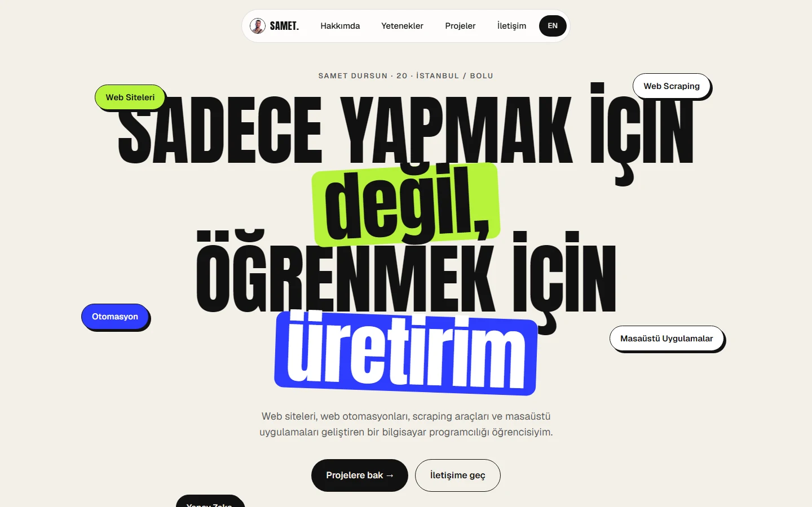

# Samet Dursun — Portfolio

Kişisel portfolio sitem. Astro ile yazılmış, statik, Türkçe ve İngilizce iki dilli tek sayfalık bir site.



## Özellikler

- **İki dil:** Türkçe `/` adresinde, İngilizce `/en/` adresinde. Metinlerin tamamı `src/i18n/` altında.
- **Scroll efektleri:** GSAP + ScrollTrigger ile bölüm geçişleri, Lenis ile yumuşak kaydırma. `prefers-reduced-motion` açıkken animasyonlar kapanır.
- **Sürüklenebilir çıkartmalar:** Fare ve dokunmatik ile çalışır.
- **İndirilebilir CV:** Türkçe ve İngilizce, tek sayfalık A4 PDF.
- **Statik çıktı:** Sunucu gerektirmez; herhangi bir statik barındırmada çalışır.

## Teknolojiler

- [Astro](https://astro.build/) 7 (TypeScript, strict)
- [GSAP](https://gsap.com/) + ScrollTrigger, [Lenis](https://lenis.darkroom.engineering/)
- Yazı tipleri: Anton (başlıklar), Geist (gövde), `@fontsource` ile projeye gömülü

## Renk paleti

| Rol | Renk |
| --- | --- |
| Kağıt (zemin) | `#f3f0e8` |
| Mürekkep | `#121212` |
| Kobalt (ana vurgu) | `#2f3cff` |
| Lime (pop vurgu) | `#b6f23a` |
| İkincil metin | `#5a5a5a` |

## Çalıştırma

Node.js gerekir.

```bash
npm install
npm run dev      # http://localhost:4321
```

| Komut | İşlev |
| --- | --- |
| `npm run dev` | Geliştirme sunucusu |
| `npm run build` | `dist/` klasörüne statik çıktı |
| `npm run preview` | Derlenmiş çıktıyı yerelde önizleme |
| `npm run check` | Tip ve şablon denetimi (`astro check`) |

## Klasör yapısı

```
src/
  pages/         index.astro (TR), en/index.astro (EN)
  layouts/       Base.astro: <head>, SEO, hreflang, yazı tipleri
  components/    Sayfa bölümleri (Hero, About, Journey, Projects, ...)
  i18n/          tr.ts, en.ts: tüm metinler
  data/          projects.ts, skills.ts
  scripts/       scroll.ts, split.ts, stickers.ts
  styles/        global.css: renk ve tipografi değişkenleri
public/          avatar görselleri, favicon, CV PDF'leri
cv/              CV'lerin HTML/CSS kaynakları
docs/            README ekran görüntüleri
```

## İçerik güncelleme

- **Metinler:** `src/i18n/tr.ts` ve `src/i18n/en.ts`. İki dosya aynı anahtarları taşır.
- **Projeler:** `src/data/projects.ts`.
- **CV:** `cv/cv.tr.html` ve `cv/cv.en.html` düzenlenir, ardından PDF'ler yeniden üretilir. Komutlar [`cv/README.md`](cv/README.md) içinde.


## 📄 Lisans

Bu proje [MIT Lisansı](LICENSE) kapsamında açık kaynak olarak sunulmaktadır.
